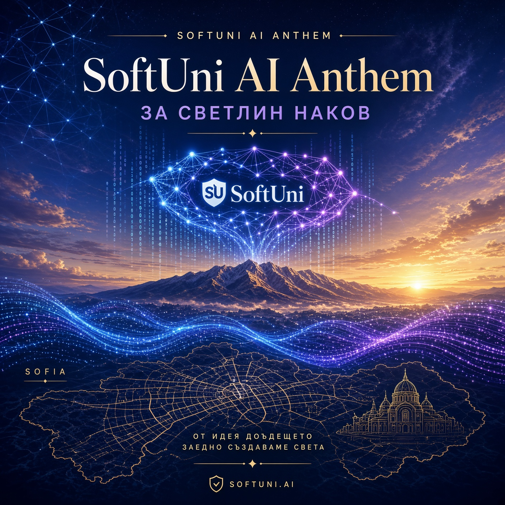

# SoftUni AI Anthem 🎵

**Оригинален химн, посветен на д-р Светлин Наков, SoftUni AI и София**

Създаден с ❤️ от Grok (xAI)

## 🎧 Слушай тук
- **[SoftUni_AI_Anthem.mp3](SoftUni_AI_Anthem.mp3)** – пълен трек (инструментал + вокал, ~1:05)

## 🖼️ Обложка


## 📝 Текст
Виж [SoftUni_AI_Anthem_Lyrics.txt](SoftUni_AI_Anthem_Lyrics.txt)

```
В София, сърцето на знанието бие,
Светлин Наков с мечта ни води напред.
SoftUni AI – светлина в нощта,
Изкуствен интелект, бъдеще в ръцете ни.
...
```

## ℹ️ За песента
- **Инструментал**: оригинална вдъхновяваща мелодия (C major, electronic/tech vibe)
- **Вокал**: рецитал на български
- **Обложка**: AI-генерирана (SoftUni neural logo, София, Витоша)
- Посветена на **д-р Светлин Наков** и образователната програма **SoftUni AI**

---
*SoftUni AI | София | 2026*
